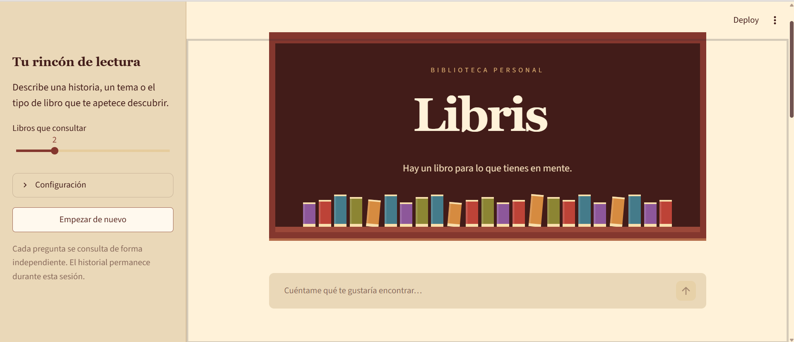
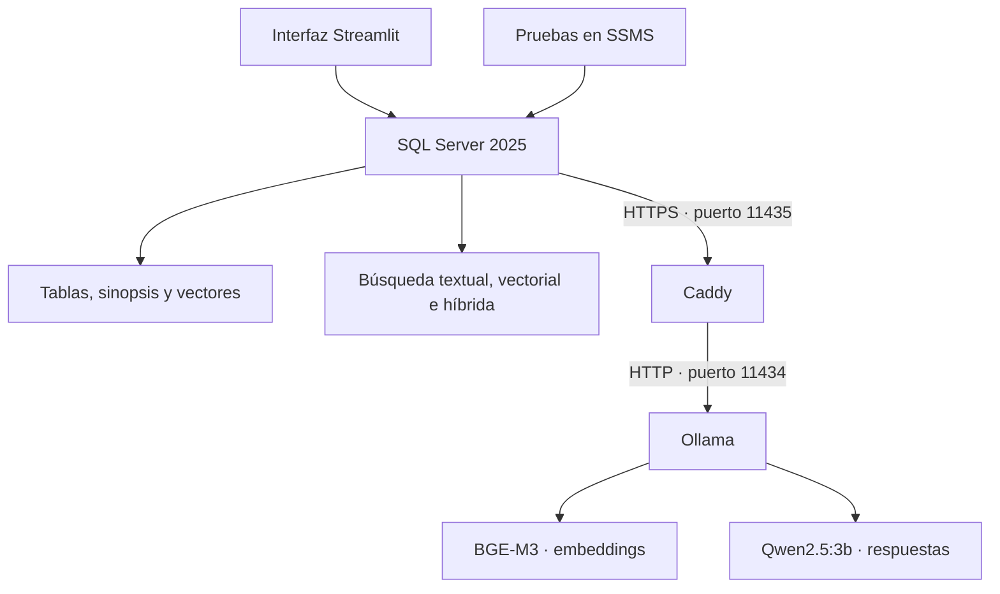
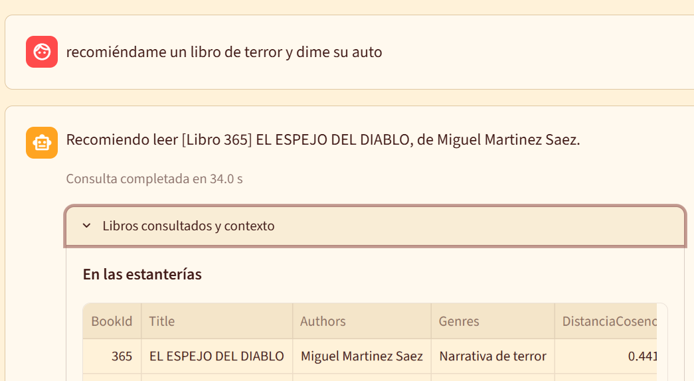

# Libris · biblioteca inteligente

Libris permite encontrar libros describiendo lo que apetece leer, sin conocer el título exacto. Combina una biblioteca en **SQL Server 2025**, búsquedas por palabras y por significado, recomendaciones por historial y un chat que responde usando información del catálogo.

Mini proyecto de **DP-800 · nivel 3**, desarrollado y probado en local. Incluye RAG e interfaz con Streamlit.



## Qué hace

- Gestiona libros, autores, géneros, socios, préstamos y valoraciones.
- Busca por palabras con Full-Text en español y por significado con embeddings.
- Combina rankings mediante RRF y permite personalizar las búsquedas.
- Recupera libros y genera una respuesta con un modelo local, mostrando las fuentes.
- Incluye pruebas de seguridad, mediciones de rendimiento y capturas.

El conjunto ampliado utilizado en las pruebas tiene **515 libros y 54 socios**, con los 515 embeddings generados. Los socios añadidos para las mediciones son ficticios.

## Arquitectura



**El chat actual recupera por distancia coseno exacta.** La búsqueda híbrida con RRF y la personalización son funciones independientes: no se incorporan automáticamente al RAG.

SQL Server prepara el contexto y llama al modelo. Python recoge la pregunta y presenta los resultados. Caddy permite que SQL Server se comunique por HTTPS con Ollama.

## Tecnologías

| Herramienta | Uso |
| --- | --- |
| SQL Server 2025 y T-SQL | Datos, seguridad, búsquedas y lógica del RAG |
| SSMS | Ejecución y comprobación de scripts |
| Ollama | Ejecución local de modelos |
| BGE-M3 | Embeddings de 1024 dimensiones |
| Qwen2.5:3b | Redacción de respuestas |
| Caddy | Proxy HTTPS para Ollama |
| Python, Streamlit, pyodbc y python-dotenv | Interfaz y conexión a SQL Server |
| Git y GitHub | Historial y entrega |

El primer modelo probado fue `all-minilm`, de 384 dimensiones. Se conserva su comparación como parte del desarrollo; **la versión actual utiliza BGE-M3**.

## Base de datos

| Tabla | Contenido |
| --- | --- |
| `Books` | Ficha, sinopsis, disponibilidad, texto de entrada y embedding |
| `Authors` y `BookAuthors` | Autores y relación de varios autores por libro |
| `Genres` y `BookGenres` | Géneros y relación de varios géneros por libro |
| `Members` | Socios |
| `Loans` | Préstamos y devoluciones |
| `Ratings` | Valoraciones |
| `SearchHistory` | Consultas de las búsquedas textual, vectorial e híbrida |

Los préstamos y las valoraciones relacionan a cada socio con los libros. El RAG consulta fichas del catálogo, no los datos personales de los socios.

## Instalación en local

### 1. Preparar el equipo

Necesitas Windows, SQL Server 2025 con Full-Text Search, SSMS, Python, Git, Ollama, Caddy y **ODBC Driver 18 for SQL Server**. El controlador ODBC se instala aparte de las dependencias Python.

```powershell
git clone https://github.com/lorenleey/libris.git
cd libris
ollama pull bge-m3
ollama pull qwen2.5:3b
```

### 2. Preparar HTTPS y el modelo externo

Configura Caddy para reenviar las peticiones de `https://localhost:11435` a Ollama. Como referencia, crea un archivo local llamado `Caddyfile`:

```caddyfile
https://localhost:11435 {
    tls internal
    reverse_proxy localhost:11434
}
```

Arranca Caddy desde la carpeta de ese archivo:

```powershell
caddy run --config .\Caddyfile
```

El certificado debe ser de confianza también para el servicio de SQL Server. Comprueba el endpoint antes de continuar:

```powershell
Invoke-RestMethod -Uri https://localhost:11435/api/embed -Method Post -ContentType 'application/json' -Body '{"model":"bge-m3","input":"novela de aventuras"}'
```

En SSMS, usa [scripts/00_validacion_entorno.sql](scripts/00_validacion_entorno.sql) **por secciones** para comprobar versión, Full-Text y habilitar las llamadas REST. Ese archivo conserva las pruebas iniciales de MiniLM: no es un instalador completo para la versión final.

Para la versión actual, registra `OllamaBgeM3` y comprueba sus 1024 dimensiones con los **pasos 1 y 2** de [ai/02.0_compare_embedding_models.sql](ai/02.0_compare_embedding_models.sql). No repitas el `CREATE EXTERNAL MODEL` si ya existe. La comparación completa requiere el antiguo catálogo con vectores MiniLM.

### 3. Crear la biblioteca

Ejecuta en SSMS, en este orden:

| Orden | Archivo | Qué prepara |
| --- | --- | --- |
| 1 | [01_create_database.sql](scripts/01_create_database.sql) | Base de datos |
| 2 | [02_create_tables.sql](scripts/02_create_tables.sql) | Tablas, relaciones e índices; ya usa VECTOR(1024) |
| 3 | [03_insert_data.sql](scripts/03_insert_data.sql) | Datos iniciales |
| 4 | [04_views.sql](scripts/04_views.sql) | Vistas y funciones de apoyo |
| 5 | [05_procedures.sql](scripts/05_procedures.sql) | Préstamos, devoluciones y trigger |
| 6 | [06_security.sql](scripts/06_security.sql) | Roles, permisos, RLS y enmascaramiento |
| 7 | [07_fulltext.sql](scripts/07_fulltext.sql) | Índice de búsqueda en español |
| 8 | [01_generate_embeddings.sql](ai/01_generate_embeddings.sql) | Texto y embeddings del catálogo inicial |
| 9 | [08_search.sql](scripts/08_search.sql) | Búsquedas y recomendaciones |
| 10 | [03_rag.sql](ai/03_rag.sql) | Recuperación de contexto y generación |

Para ampliar el catálogo como en las pruebas:

1. Ejecuta [09_ampliar_libris_500_libros_50_socios.sql](scripts/09_ampliar_libris_500_libros_50_socios.sql).
2. Repite [10_generar_embeddings_lotes.sql](scripts/10_generar_embeddings_lotes.sql) hasta que `Pendientes` sea 0. Actualmente procesa hasta 50 libros por ejecución.
3. Comprueba cantidades y dimensiones con la primera parte de [11_verificar_y_medir.sql](scripts/11_verificar_y_medir.sql).

La ampliación incorpora 500 fichas de libros con su referencia de origen en el propio script, más 50 socios ficticios y actividad de prueba. La base inicial aporta 15 libros y 4 socios.

**Si partes de la versión antigua con VECTOR(384)**, utiliza [02.1_migrate_to_bge_m3.sql](ai/02.1_migrate_to_bge_m3.sql) antes de regenerar los vectores. Este archivo elimina los embeddings antiguos: no es necesario en una instalación nueva que ya tiene VECTOR(1024). Algunos comentarios de los scripts conservan nombres antiguos; los enlaces de esta guía corresponden a los archivos actuales.

### 4. Abrir la interfaz

Desde la raíz del repositorio:

```powershell
Copy-Item env.example .env
python -m pip install -r requirements.txt
```

Edita `.env`. Para SQL Server local con autenticación de Windows:

```dotenv
SQL_CONN_STRING=DRIVER={ODBC Driver 18 for SQL Server};SERVER=localhost;DATABASE=Libris;Trusted_Connection=yes;TrustServerCertificate=yes;
LIBRIS_CHAT_MODEL=qwen2.5:3b
```

Si en SSMS utilizas otro nombre de servidor, cambia `SERVER` por ese valor. Conserva `.streamlit/config.toml` para aplicar el tema.

```powershell
python -m streamlit run app.py
```

Abre la dirección local que indique la terminal y mantén Ollama y Caddy en marcha. `.env` está excluido de Git; `env.example` es la plantilla pública.

## Ejemplos y comprobaciones

```sql
USE Libris;
GO
EXEC dbo.usp_SearchBooksText @Query = N'fantasía', @Top = 5;

EXEC dbo.usp_SearchBooksSemantic
    @Query = N'una historia sobre empezar de nuevo', @Top = 5;

EXEC dbo.usp_SearchBooksHybrid
    @Query = N'viajes y otros mundos', @Top = 5;

DECLARE @respuesta NVARCHAR(MAX);
EXEC dbo.usp_AskLibris
    @Question = N'Recomiéndame un libro de terror y dime su autor',
    @Answer = @respuesta OUTPUT,
    @ShowEvidence = 1;
```

En una prueba desde la interfaz, Libris recomendó **El espejo del diablo**, de Miguel Martinez Saez, y el autor se comprobó también en SQL.



Los scripts de `tests/` cubren objetos SQL, seguridad, búsquedas y RAG. Ejecuta las pruebas por bloques y revisa sus resultados. [prueba_final.sql](tests/prueba_final.sql) comprueba el volumen, los embeddings, la disponibilidad y una llamada completa al chat.

## Requisitos DP-800 cubiertos

| Bloque | Implementación y evidencia |
| --- | --- |
| A · Diseño y T-SQL | Tablas relacionadas, claves, restricciones, índices, vistas, funciones, procedimientos y trigger; [tests de fase 3](tests/fase3_tests.sql) |
| B · Desarrollo con IA | Apoyo de ChatGPT, decisiones y correcciones documentadas en [desarrollo.md](desarrollo.md) |
| C · Seguridad | Roles, permisos, RLS y enmascaramiento; [tests de fase 4](tests/fase4_tests.sql) |
| D · Optimización | Cinco parejas de mediciones y equivalencia para un socio; resultados y limitaciones en [desarrollo.md](desarrollo.md) |
| E · Embeddings | BGE-M3, texto de las fichas y VECTOR(1024) |
| F · Intelligent Search | Full-Text, distancia coseno, RRF y afinidad; [tests de fase 6](tests/fase6_tests.sql) |
| G · RAG | Pregunta, fuentes, contexto y respuesta visibles; [tests de fase 7](tests/fase7_tests.sql) e interfaz |

En las cinco mediciones locales, la alternativa de afinidad redujo la mediana del tiempo de **1834 a 985 ms** y la mediana de CPU de **1250 a 125 ms**. La definición de `usp_TestMemberAffinity` aún no está incluida en el repositorio: los scripts 11 y 12 la requieren para repetir esa comparación. Las búsquedas publicadas siguen usando la función original.

## Organización del repositorio

| Ruta | Contenido |
| --- | --- |
| `scripts/` | Base de datos, seguridad, búsquedas, ampliación y mediciones |
| `ai/` | Embeddings, comparación de modelos, migración y RAG |
| `tests/` | Pruebas SQL |
| `img/` | Capturas de ejecución |
| `docs/` | Material de apoyo |
| `app.py` | Interfaz |
| `.streamlit/` | Tema visual |
| `desarrollo.md` | Fases, decisiones, incidencias y resultados |

## Conclusiones y mejoras

Libris permite demostrar el recorrido completo desde una pregunta hasta una respuesta apoyada en datos de SQL Server. Durante el proyecto aprendí a conectar servicios locales, elegir y cambiar un modelo de embeddings, evaluar respuestas y medir una optimización sin perder de vista los resultados.

La interfaz está probada en local. Cada pregunta es independiente, aunque se muestre un historial. Las fuentes son fichas y sinopsis, no libros completos. Recuperar los libros más próximos no garantiza que respondan a cualquier pregunta.

Las pruebas detectaron respuestas útiles, abstenciones correctas y casos mejorables: copia de fichas ante una petición engañosa y abstención en una consulta de ciencia ficción. Queda reforzar y evaluar las instrucciones, revisar la relevancia de las fuentes y completar la publicación de la alternativa de optimización. La aplicación usa la identidad de Windows configurada para la conexión; no implementa acceso individual de socios.

## Ayuda de ChatGPT

Desarrollé el proyecto con apoyo de **ChatGPT, utilizando ChatGPT Plus**, para comprender conceptos, recibir recomendaciones de herramientas, revisar errores, preparar consultas y pruebas, personalizar la interfaz y redactar documentación. Entre las herramientas propuestas durante el acompañamiento estuvieron Ollama, Caddy y Streamlit.

Plus es el plan utilizado; el modelo exacto de cada conversación no quedó registrado. ChatGPT es el asistente de desarrollo; **el modelo que responde dentro de Libris es Qwen2.5:3b**, ejecutado con Ollama. Las propuestas se probaron en mi equipo y se corrigieron cuando no coincidían con el código o los resultados reales.
