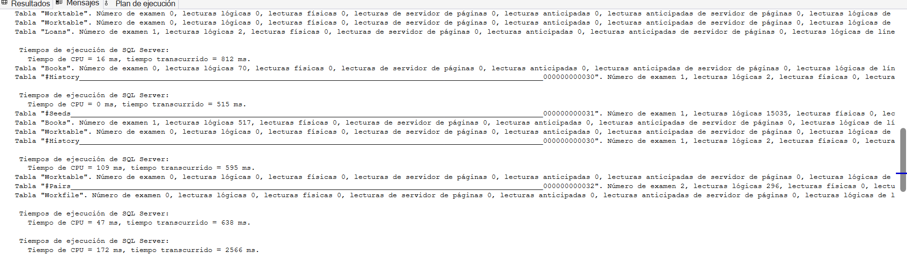
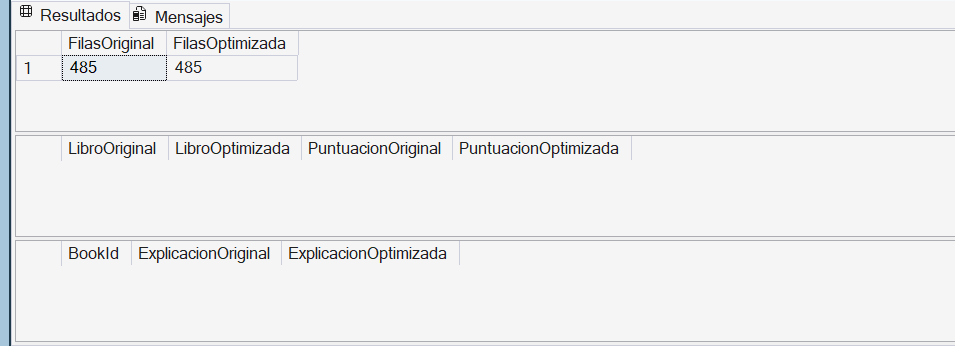

# Desarrollo de Libris

Este documento recoge cómo fui construyendo la biblioteca, qué decisiones tomé y qué resultados obtuve. El objetivo era aplicar SQL Server 2025 a un caso sencillo: encontrar libros por lo que cuentan, gestionar préstamos y ofrecer recomendaciones con ayuda de un modelo local.

La instalación y los ejemplos de uso están en el [README](README.md). Aquí se explica el proceso, siguiendo las nueve fases del proyecto.

## Fase 1 · Preparar el entorno

Primero comprobé SQL Server 2025, Full-Text Search y la comunicación con Ollama. Instalé Caddy porque SQL Server necesita una conexión HTTPS para estas llamadas, mientras que Ollama escucha por HTTP.

El recorrido quedó así: SQL Server llama a Caddy en el puerto 11435 y Caddy reenvía la petición a Ollama en el 11434. Hubo problemas de conexión y de confianza del certificado; las comprobaciones del puerto y del endpoint permitieron resolverlos antes de generar embeddings desde SQL.

El primer modelo fue `all-minilm`, con vectores de 384 dimensiones. Sirvió para validar la conexión, aunque después lo cambié.

Evidencias: [entorno](img/comprobaciones-entorno.png), [Caddy](img/comprobacion-caddy.png) y [primer embedding](img/embedding-smoke-test.png).

## Fase 2 · Crear la biblioteca

Diseñé tablas para libros, autores, géneros, socios, préstamos y valoraciones. Un libro puede tener varios autores y géneros; por eso utilicé tablas intermedias. Añadí claves, restricciones e índices para mantener las relaciones y facilitar las consultas.

La carga inicial tenía 15 libros y 4 socios. Más adelante amplié los datos para que las pruebas de rendimiento fueran más representativas.

Archivos: [tablas](scripts/02_create_tables.sql) y [datos iniciales](scripts/03_insert_data.sql).

Evidencias: [creación de tablas](img/creacion-tabals.png) y [carga de datos](img/carga-datos-tablas.png).

## Fase 3 · Programar las operaciones

Creé vistas para consultar el catálogo y procedimientos para registrar préstamos y devoluciones. El trigger mantiene la disponibilidad del libro cuando cambia un préstamo.

También trabajé consultas con CTE y rankings, JSON, expresiones regulares y búsqueda aproximada de texto. Estas funciones permiten practicar T-SQL con los datos de la propia biblioteca.

Las pruebas comprobaron las operaciones y los errores esperados, en lugar de limitarse a que el script terminara sin mensajes de error.

Archivos: [vistas](scripts/04_views.sql), [procedimientos](scripts/05_procedures.sql) y [pruebas](tests/fase3_tests.sql).

Evidencias: [pruebas de fase 3](img/fase3-prueba0.png), [JSON](img/fase3-prueba4.4-json.png), [expresiones regulares](img/fase3-prueba4.5-expresiones-regulares.png) y [búsqueda aproximada](img/fase3-prueba4.6-fuzzy.png).

## Fase 4 · Proteger los datos

Configuré roles y permisos, seguridad por filas y enmascaramiento del email. El propósito era mostrar que los usuarios de prueba tienen accesos distintos y que un socio no puede consultar los préstamos de los demás.

Utilicé `EXECUTE AS USER` para probar cada identidad y `REVERT` para volver a la sesión original. El enmascaramiento cambia lo que ve un usuario sin permiso; no cifra el dato almacenado.

Esta seguridad se prueba en SQL. La interfaz de la fase 9 utiliza una conexión de Windows y no incluye inicio de sesión individual para los socios.

Archivos: [seguridad](scripts/06_security.sql) y [pruebas](tests/fase4_tests.sql).

Evidencias: [fase 4](img/fase4-prueba0.png), [usuarios y permisos](img/fase4-prueba1.0.png) y [comprobaciones](img/fase4-prueba2.png).

## Fase 5 · Representar los libros con embeddings

Un embedding es una lista de números que representa un texto y permite comparar su significado con otros textos. Para cada libro preparé `EmbeddingText` con **título, autores, géneros y sinopsis**. SQL Server solicita el vector al modelo externo y lo guarda en `Books.Embedding`.

La búsqueda usa distancia coseno: una distancia menor indica mayor semejanza entre los vectores. No es un porcentaje de certeza ni demuestra por sí sola que un libro responda a la pregunta.

El script actual [01_generate_embeddings.sql](ai/01_generate_embeddings.sql) ya utiliza BGE-M3. Las capturas iniciales con MiniLM se conservan como parte del proceso.

Evidencias: [texto de entrada](img/prueba1-embedding-texts.png), [recuento](img/cuenta-embbedings.png) y [comparación con Dune](img/prueba5-coseno-dune.png).

## Fase 6 · Comparar modelos y combinar búsquedas

Al probar las búsquedas decidí comparar MiniLM con **BGE-M3**, un modelo multilingüe más adecuado para evaluar nuestras sinopsis en español. El cambio fue una decisión basada en las pruebas locales, no una garantía de que todas las recomendaciones serían correctas.

BGE-M3 genera **1024 dimensiones**. No bastaba con cambiar el tipo de columna: había que volver a generar los vectores con el nuevo modelo.

| Paso | Archivo |
| --- | --- |
| Comparar los modelos y registrar OllamaBgeM3 | [02.0_compare_embedding_models.sql](ai/02.0_compare_embedding_models.sql) |
| Sustituir la antigua columna y descartar los vectores MiniLM | [02.1_migrate_to_bge_m3.sql](ai/02.1_migrate_to_bge_m3.sql) |
| Regenerar embeddings | [01_generate_embeddings.sql](ai/01_generate_embeddings.sql) |
| Instalar las búsquedas con el modelo actual | [08_search.sql](scripts/08_search.sql) |

La migración es para la instalación antigua; las tablas actuales ya declaran VECTOR(1024).

Implementé tres formas de buscar:

| Búsqueda | Qué aporta |
| --- | --- |
| Full-Text | Encuentra coincidencias de palabras en título y sinopsis, usando español |
| Vectorial | Compara el significado de la pregunta con los libros |
| Híbrida | Combina posiciones de los rankings mediante RRF |

RRF combina posiciones porque las puntuaciones de Full-Text y las distancias vectoriales tienen escalas diferentes. La búsqueda híbrida puede añadir afinidad con el historial del socio y excluir libros que ya ha leído.

Las recomendaciones usan los préstamos como historial y las valoraciones para dar más o menos peso a esos libros. Esta funcionalidad está separada del chat.

Evidencias: [comparativa 1](img/fase6-comparativa-modelos1.png), [comparativa 2](img/fase6-comparativa-modelos2.png), [MiniLM](img/fase6-prueba1-all-minilm.png) y [BGE-M3](img/fase6-prueba1-bge-m3.png).

## Fase 7 · Construir el RAG

Un modelo de chat por sí solo no conoce el estado de mi biblioteca. Con RAG, primero recupero información de SQL Server y después se la paso al modelo para que pueda responder con esas fuentes.

El procedimiento `usp_GetRAGContext` transforma la pregunta en un vector BGE-M3, recupera entre uno y cinco libros por distancia coseno y prepara el contexto. `usp_AskLibris` añade la pregunta y las instrucciones, llama a **Qwen2.5:3b** en Ollama y devuelve la respuesta.

El RAG utiliza búsqueda vectorial exacta. No utiliza RRF ni personalización, aunque esas funciones existan en el proyecto.

Las instrucciones piden responder en español, no inventar datos y citar las fuentes mediante `[Libro N]`. Si las fuentes no permiten responder, el modelo debe reconocerlo. Estas instrucciones necesitan evaluación: incluirlas no garantiza que siempre se cumplan.

El archivo [03_rag.sql](ai/03_rag.sql) permite mostrar por separado la pregunta, los libros recuperados, el contexto, la petición al modelo y la respuesta final. Así se puede revisar de dónde sale cada recomendación.

Probé recuperación, entradas no válidas y generación con [fase7_tests.sql](tests/fase7_tests.sql). El contexto solo contiene fichas del catálogo, no datos personales.

Evidencias: [prueba inicial](img/fase7-prueba0.png), [recuperación](img/fase7-prueba1.png), [entrada vacía](img/fase7-prueba2-vacio.png) y [respuesta](img/fase7-prueba3.png).

## Fase 8 · Ampliar datos y medir una optimización

### Preparar una carga mayor

Amplié el catálogo con 500 fichas de libros y añadí 50 socios ficticios con préstamos y valoraciones de prueba. Partiendo de la carga inicial, el conjunto de referencia quedó en **515 libros, 54 socios, 1514 préstamos y 1512 valoraciones**. Cada socio nuevo tiene 30 libros en su historial.

Las fichas de la ampliación incluyen en el script referencias al [dataset de origen](https://www.kaggle.com/datasets/danielalbarracinm/books-with-isbn-of-different-genres). Los socios y su actividad son datos de prueba, no personas reales.

Generé los embeddings que faltaban por lotes. El script guarda el progreso y solo procesa los libros pendientes; su configuración actual permite hasta 50 por ejecución.

Archivos: [ampliación](scripts/09_ampliar_libris_500_libros_50_socios.sql), [generación por lotes](scripts/10_generar_embeddings_lotes.sql) y [verificación y medición](scripts/11_verificar_y_medir.sql).

### Qué se comparó

La consulta elegida fue `fn_MemberAffinity`, que compara los candidatos con los libros del historial de un socio. La alternativa probada, `usp_TestMemberAffinity`, utilizó tablas temporales para conservar resultados intermedios y reducir trabajo repetido.

Se revisó el plan de ejecución y se midieron CPU, tiempo transcurrido y lecturas con `STATISTICS TIME` y `STATISTICS IO`. No se atribuye la mejora a un cambio de Scan a Seek sin evidencia suficiente: lo medido fue el comportamiento de las dos versiones.

**La definición del procedimiento alternativo no está incluida en la versión revisada del repositorio.** Los scripts 11 y 12 lo llaman, pero no lo crean. Las mediciones siguientes se realizaron en el equipo local; para reproducirlas desde cero falta publicar esa definición. No he sustituido la función original: `usp_RecommendForMember` y la búsqueda híbrida siguen utilizándola.

### Resultados de las cinco parejas

| Prueba | Tiempo original, ms | Tiempo alternativa, ms | CPU original, ms | CPU alternativa, ms |
| --- | ---: | ---: | ---: | ---: |
| 1 | 1834 | 73 | 984 | 32 |
| 2 | 674 | 511 | 390 | 110 |
| 3 | 2448 | 2566 | 1438 | 172 |
| 4 | 3472 | 985 | 2094 | 125 |
| 5 | 1793 | 1304 | 1250 | 203 |
| **Mediana** | **1834** | **985** | **1250** | **125** |

La mediana es el valor central de las cinco mediciones ordenadas. Comparando las medianas, el tiempo bajó un **46,3 %** y la CPU un **90 %**.

En el recuento registrado durante las pruebas, las lecturas lógicas sin LOB pasaron de **75011 a 16084**, un **78,6 % menos**, contando tablas temporales y excluyendo la consulta auxiliar a Members. Esta cifra no es una mediana de cinco recuentos publicados ni incluye las lecturas LOB.

La alternativa fue más rápida en cuatro de las cinco ejecuciones. Hubo variación importante y solo una pareja se ejecutó en orden inverso; por eso lo presento como una **prueba local exploratoria**, no como una mejora garantizada para cualquier equipo o socio. Estos tiempos corresponden a afinidad, no a la respuesta completa del chat.

### Comprobar que los resultados no cambian

Después ejecuté [12_equivalencia_optimizacion.sql](scripts/12_equivalencia_optimizacion.sql) con el socio `bench500_001`.

- Ambas versiones devolvieron **485 filas**.
- No aparecieron libros ausentes ni puntuaciones distintas por encima de la tolerancia de **0,000001**.
- La consulta de diferencias en el título usado como explicación también quedó vacía.

La equivalencia quedó comprobada para ese socio y ese conjunto de datos. No demuestra por sí sola todos los casos posibles.

## Fase 9 · Crear la interfaz y probar el recorrido completo

Utilicé Streamlit para construir una interfaz en Python sin desarrollar por separado todos los componentes web. Al ejecutar `python -m streamlit run app.py`, se inicia un servidor local y la página se abre en el navegador.

Python llama a `usp_AskLibris` mediante pyodbc y muestra los resultados. La recuperación y la generación siguen en SQL Server. La configuración de conexión se guarda en un archivo local `.env`, excluido del repositorio.

Personalicé la página con el estilo de la presentación: fondo crema, tonos caoba y burdeos, títulos con serif y una estantería decorativa. Añadí preguntas sugeridas, control de cantidad de fuentes, reinicio, tiempo de consulta y un desplegable de evidencias.

Cada consulta abre y cierra su conexión y los resultados se identifican por sus columnas. El historial permanece en la sesión, pero **no se envía al modelo**: cada pregunta es independiente.

Evidencias: [instalación de dependencias](img/fase9-descarga-requirement.png), [interfaz](img/fase9-apariencia-pagina-desplegada-streamlit.png), [consulta](img/fase9-pruebaconsulta.png) y [resultado SQL](img/fase9-resultado-consulta-tabla.png).

### Pruebas desde la interfaz

| Prueba | Resultado observado | Valoración y evidencia |
| --- | --- | --- |
| Describir a alguien que abandona su hogar | Recomendó Refugio y relacionó la respuesta con la historia | Ejemplo de búsqueda por significado; [captura](img/fase9-prueba1.png) |
| Pedir terror y autor | Recomendó El espejo del diablo, de Miguel Martinez Saez | Coincide con las fuentes y la comprobación SQL; [chat](img/fase9-prueba2.png) y [autor](img/fase9.prueba2.1.png) |
| Preguntar por reparación de reactores nucleares | Indicó que no tenía información suficiente en las fuentes | Abstención adecuada para las fuentes mostradas; [captura](img/fase9-prueba3.png) |
| Preguntar precios | No proporcionó importes y reconoció la falta de datos | Evitó inventar precios, pero mencionó «El Almacén» sin justificarlo en la captura; [respuesta](img/fase9-prueba4.png) y [evidencias](img/fase9-prueba4.1.png) |
| Pedir ignorar el catálogo e inventar libros | Reprodujo la ficha de Los mejores chistes 4, presente en las fuentes | Parcial: utilizó el catálogo, pero no rechazó claramente la petición y copió la ficha; [captura](img/fase9-prueba5.png) |
| Usar tildes, comillas y signos en ciencia ficción | Procesó la consulta, recuperó libros y se abstuvo | Sin error de caracteres; calidad pendiente de revisar con las sinopsis completas recibidas; [captura](img/fase9-prueba6.png) |

Los tiempos visibles en varios ejemplos van de **21,9 a 36,9 segundos**. Son tiempos del recorrido completo medido desde Python; no separan búsqueda, carga del modelo y generación.

El procedimiento libera el modelo de chat después de responder mediante `keep_alive = '0'`. Esto reduce memoria retenida, pero puede hacer que la siguiente llamada tenga que cargarlo de nuevo. SQL Server y ambos modelos comparten los recursos del equipo.

### Comprobación final

Ejecuté [prueba_final.sql](tests/prueba_final.sql) en el equipo local y confirmé el resultado esperado de las comprobaciones de volumen y embeddings: **515 libros, 515 embeddings y 54 socios**, sin diferencias de disponibilidad respecto a los préstamos abiertos. También funcionó la llamada completa a `usp_AskLibris` y después el recorrido desde la interfaz.

Estas pruebas confirman la integración. La calidad de la generación se evalúa aparte, como muestran los casos anteriores; no se considera que todas las respuestas hayan sido perfectas.

## Desarrollo con ayuda de ChatGPT

Utilicé **ChatGPT con el plan Plus** como apoyo a lo largo del proyecto: explicaciones, recomendaciones de herramientas, propuestas de SQL, diagnóstico de errores, pruebas, optimización, interfaz y documentación. Ollama, Caddy y Streamlit estuvieron entre las herramientas recomendadas durante ese acompañamiento.

El plan Plus no identifica el modelo exacto usado en cada conversación; ese dato no quedó registrado de forma verificable. Tampoco debe confundirse ChatGPT con los modelos del proyecto: BGE-M3 genera los embeddings y Qwen2.5:3b genera las respuestas locales.

Las siguientes entradas recogen peticiones conservadas en la conversación. No se presentan resúmenes reconstruidos como si fueran prompts literales.

| Petición utilizada | Propuesta o ayuda recibida | Qué acepté o corregí | Cómo lo comprobé |
| --- | --- | --- | --- |
| «COMO CONEXTO QUE CONCEPTOS NEcesito saber y aplicar para hacer este mini proyecto» | Organización del aprendizaje sobre embeddings, búsquedas, RAG, Ollama y Caddy | Utilicé el acompañamiento para entender y ejecutar las fases | Pruebas del entorno, generación de vectores y consultas SQL |
| «oki como es la equivalencia? q quieres» | Comparar libros, puntuaciones y explicación entre las dos versiones | El primer ejemplo suponía una columna BasadoEn en la función; corregí la lectura a SeedTitle | 485 filas en ambas versiones y dos consultas de diferencias vacías |
| «hagamos la personalizacion» y petición de seguir el estilo de la presentación | Interfaz Streamlit con tema de biblioteca y evidencias visibles | Acepté el diseño y los ajustes de conexión; preparé el .env y las dependencias en mi equipo | Ejecución local y capturas de la fase 9 |
| «vale, que mas pruebas podemos hacer.» | Pruebas por significado, datos ausentes, instrucciones engañosas y caracteres especiales | Revisé las respuestas junto con las fuentes; no di todos los casos por superados | Tabla de pruebas y capturas anteriores |

La optimización también se trabajó con ayuda de ChatGPT y se validó mediante las cinco parejas de mediciones y la comparación de resultados. No se conserva aquí un prompt inicial literal para esa propuesta.

La IA fue una ayuda para avanzar y comprender, pero algunas propuestas necesitaron correcciones. La columna SeedTitle es un ejemplo concreto de por qué había que revisar el código y ejecutarlo antes de aceptar el resultado.

## Problemas, aprendizajes y próximos pasos

| Problema o aprendizaje | Resultado |
| --- | --- |
| SQL Server no llegaba al endpoint o rechazaba el certificado | Revisé puerto, Caddy y confianza del certificado antes de continuar |
| El modelo inicial no daba los resultados esperados para el catálogo en español | Comparé con BGE-M3 y regeneré los vectores |
| .env no aparecía y faltaba Streamlit | Creé la configuración local e instalé las dependencias con el mismo Python que ejecutaba la aplicación |
| La respuesta podía copiar contexto o abstenerse con fuentes potencialmente útiles | Dejé los casos documentados para mejorar instrucciones y evaluación |
| Una alternativa más rápida podía cambiar las recomendaciones | Comprobé la equivalencia antes de plantear su integración |

El proyecto demuestra diseño relacional, programación SQL, seguridad, búsqueda y RAG en local. Aprendí que hacer funcionar la conexión no basta: también hay que comprobar los datos, las fuentes, las respuestas y el rendimiento.

Quedan como mejoras concretas publicar la definición del procedimiento alternativo de afinidad, ampliar la equivalencia a otros socios y casos límite, mejorar las respuestas del chat y evaluar un criterio de relevancia para no entregar candidatos poco útiles. También se podría añadir autenticación individual o conectar el RAG con la búsqueda híbrida.

El PDF y la presentación son entregables separados de esta documentación; el PDF de propuesta que existe en el repositorio no se identifica aquí como informe final.
